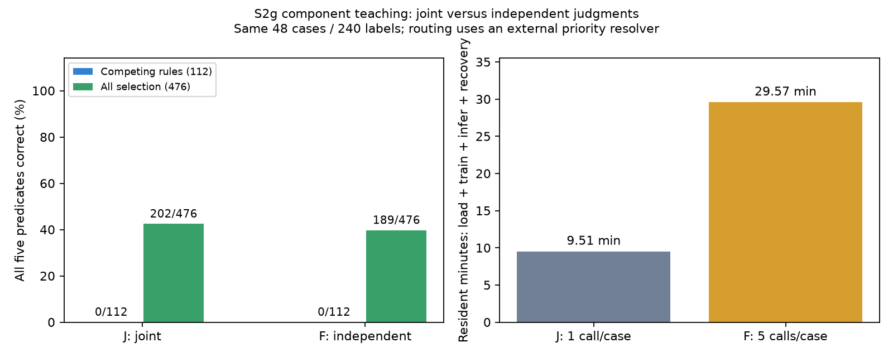

# Can a small model learn reusable policy rules?

The completed pilot finds that two component-teaching recipes fail on unseen
combinations of rules. A useful next step is to establish that the student learns
each training rule reliably before testing broader transfer.

## Experiment

The task is a fictional support policy with ten Boolean facts and five rules.
The 48 training cases have at most one active rule. Students must later identify
every applicable rule, including cases with several active rules. Labels are
deterministic and checked against the policy; this study uses no frontier teacher.

Both students use Qwen3-0.6B revision
`c1899de289a04d12100db370d81485cdf75e47ca`, identical initial LoRA parameters,
seed 17, the same 240 Boolean labels, and 120 optimizer updates over ten epochs.
The frozen base uses fp16; LoRA uses fp32, rank 8, alpha 16 and q/v projections.
AdamW has learning rate 0.0001 and zero weight decay. Training uses 192 padded
tokens, microbatch one and gradient clipping at norm one.

**Joint** predicts five truth values in one response. **Independent** answers five
separate binary questions using one shared adapter. Neither receives the rule
formula or another component's answer at inference. Boolean/EOS loss mass is
matched at 5/6 versus 1/6. Independent training averages 20 records per update;
joint training averages four. Equal labels and updates therefore involve different
compute costs. Each rule has eight true and 40 false training labels.

## Results

| All five judgments correct | Joint | Independent |
|---|---:|---:|
| Training | 42/48 | 16/48 |
| Diagnostic | 15/24 | 7/24 |
| Full selection | 202/476 | 189/476 |
| Competing-rule selection | 0/112 | 0/112 |
| Training forwards | 480 | 2,400 |
| Inference calls | 548 | 2,740 |
| Resident model time | 9.51 min | 29.57 min |



Both arms completed their planned work without malformed or missing responses,
update replay or new resource failures. The practical promotion gate failed.
The [full aggregate](../results/teaching_policy_v1/s2g_6dea579a0622.json) includes
per-rule recalls, false positives/negatives, constant-false baselines, paired
transitions, token counts and checkpoint identities.

The joint student predicts exactly one active rule on all 112 competing-rule
cases. This is consistent with the zero-or-one-active pattern in its training
sample; the observation does not identify the neural cause. The independent
student predicts false for rules 2–5 on every training case, missing all 32
positive labels for those rules. Independent querying did not repair learning.

Secondary routing accuracy is 291/476 versus 234/476. Routing uses **student
predicates + an external priority resolver**. Correct routing can coexist with
an incomplete rule vector, and the resolver supplies the policy order.

## Information available in the labels

A subsequent diagnostic fits conjunctions of Boolean features using only the
48 training cases. Each rule has a unique shortest conjunction consistent with
its training labels. The resulting symbolic predictor scores 476/476 selection
vectors, including 112/112 competing-rule cases.

This control receives structured features and a conjunction-only hypothesis
class informed by benchmark construction. It tests whether that representation
can identify the rules from the labels; it does not learn language extraction or
demonstrate a neural teaching benefit. It was added after inspecting the neural
results. Counts and selection criteria are in the
[diagnostic aggregate](../results/teaching_policy_v1/s2g_6dea579a0622_results_review.json).

## Limits and next experiment

This is one seed, one fictional policy and development-exposed selection.
Independent confirmation remains unused. The result establishes no generic
transfer, frontier-teacher advantage, label saving or cost saving.

Times measure model residence during loading, training, evaluation and recovery
on the local machine. They are not electricity or cloud-price estimates. Earlier
failed attempts add 25.20 seconds to the 39.08-minute completed run, giving 39.50
minutes across the experiment lineage. CPU preparation is recorded separately.

The next controlled change is to balance the independent student's true/false
loss using training class counts, while keeping its data, initialization and
schedule fixed. A training-mastery gate will precede expanded evaluation. This
tests one plausible cause of its observed failure; success is not assumed.

## Reproduce the figure

This release supports reporting from committed aggregates. Training reproduction
currently depends on local prepared experiment state. Private example text,
responses and model checkpoints are excluded from the release.

```bash
python -m pip install -e ".[report]"
python scripts/plot_component_results.py
```

The script writes `data/generated/component_results.png` and prints the source
aggregate hash. With the recorded plotting environment, the PNG is byte identical
to the committed figure. Plotting makes no model calls.
